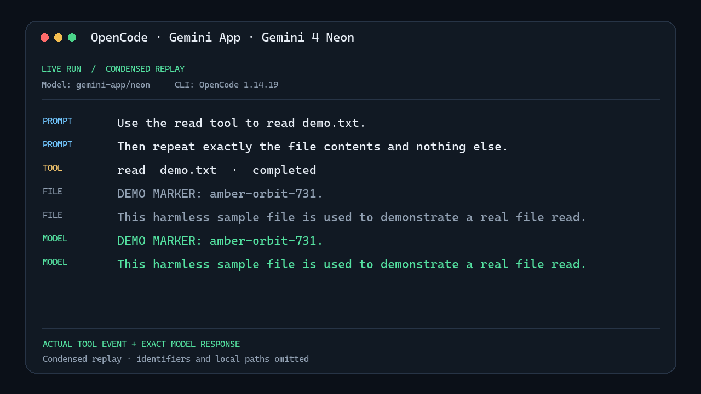

# gemini-jio-argon

**gemini-jio-argon** connects OpenCode to a local OpenAI-compatible bridge driven by a Chrome extension that sends requests through an inactive tab in your signed-in Gemini web app. It pairs with a Windows T3 Code fork that adds a native Gemini provider alongside your standard T3 Code installation, defaulting to **Gemini 4 Neon** where your account supports it.

[Windows T3 Code fork](https://github.com/Invictine/t3code/tree/feat/gemini-native-provider) · [Setup](#setup) · [Reliability checks](docs/reliability-report.md)

## Live OpenCode terminal demo

[](assets/demo/neon-file-read.mp4?raw=true)

[Watch the short MP4](assets/demo/neon-file-read.mp4?raw=true). The condensed clip follows a live OpenCode run as it reads a scratch file and returns its contents through the local bridge.

## Compatibility and access

This project is unofficial. Gemini account quotas, model availability, and web UI updates can interrupt requests. The docs and T3 Code fork are public. Setup requires access to the private, pinned bridge dependency while its upstream licensing is unresolved.

## Architecture

```
T3 Code fork (branch feat/gemini-native-provider, native "Gemini" provider)
  -> GeminiDriver -> native OpenCode executable
      -> OpenCode "gemini-app" provider  (config forced via env vars)
          -> local bridge  http://127.0.0.1:8100/v1  (vendor/gemini-web-api)
              -> signed-in Gemini tab (Chrome backend) or saved session (cookie backend)
```

Load the unpacked `vendor/gemini-web-api/extension` in the signed-in Chrome profile, set `GEMINI_BACKEND=chrome` in the project `.env`, and start the bridge in the background. The extension uses an inactive Gemini tab and selects the exact model. The [installed-extension check](#testing-the-installed-chrome-extension) can open that tab for you and verify Neon through the local API.

The T3 Code fork's `feat/gemini-native-provider` branch adds **Gemini** under Settings → Providers. Its Sign in dialog verifies saved cookies for the cookie backend. That setup is documented below. The [validation report](docs/reliability-report.md) tracks live Chrome and T3 results separately.

## ⚠️ Read this first

- This is **unofficial, reverse-engineered** access to the Gemini web app. It may **violate Google's Terms of Service** and can lead to **account restrictions or termination**.
- Use a **secondary / throwaway Google account** if at all possible.
- **Web-app quotas and rate limits apply** (not API quotas). Heavy use can trip abuse detection.
- Google deploys changes constantly: **RPC IDs and cookie handling can break without notice**. When that happens, update the vendored bridge (see Maintenance).

## Prerequisites

- **Python 3.12 and uv** for the local bridge.
- **Windows** and the [T3 Code fork](https://github.com/Invictine/t3code/tree/feat/gemini-native-provider) on `feat/gemini-native-provider`. Follow the fork's toolchain instructions for Node.js and `vp`.
- **Native OpenCode 1.x executable** — the provider launches it with a local Gemini config. Set **OpenCode executable** in the provider settings to override discovery. OpenCode 1.14.19 was tested with this fork.
- **Chrome**, logged into <https://gemini.google.com> with an account whose model picker offers **4 Neon**.

## Setup

### 1. Install T3 Code (Gemini) on Windows

The Gemini edition installs alongside regular T3 Code with its own app identity and settings. To build the Windows installer, use the toolchain from the fork's README and run the following.

```powershell
git clone --branch feat/gemini-native-provider https://github.com/Invictine/t3code.git
cd t3code
vp i
vp run dist:desktop:win:gemini
```

Run the resulting installer and open **T3 Code (Gemini)** from the Start menu. The native provider expects a compatible OpenCode 1.x executable. Install the tested version into the per-user runtime location, or set a compatible executable in the Gemini provider settings:

```powershell
npm install --prefix "$env:LOCALAPPDATA\T3 Code (Gemini)\runtime\opencode" --no-audit --no-fund opencode-ai@1.14.19
```

#### Run from source instead

From your T3 Code fork checkout, switch to the Gemini branch and start the desktop development build.

```powershell
git checkout feat/gemini-native-provider
vp i                       # install workspace dependencies (see the fork's README for `vp`)
npm run dev:desktop        # or: npm run build:desktop && npm run start:desktop
```

Keep that T3 build running — it is the app you will configure below. The fork's README has the full toolchain setup (Node.js version, `vp`, etc.).

### 2. Set up the signed-in Chrome bridge

With access to the pinned dependency, clone this project and install the bridge.

```powershell
git clone --recurse-submodules https://github.com/Invictine/gemini-jio-argon.git
cd gemini-jio-argon
uv sync --locked --project vendor/gemini-web-api
Copy-Item .env.example .env
```

Set `GEMINI_BACKEND=chrome` in `.env`. In the Chrome profile where you are signed in to Gemini, open `chrome://extensions`, turn on **Developer mode**, and use **Load unpacked** to select `vendor/gemini-web-api/extension`. Keep Chrome running.

Start the bridge and check that it responds.

```powershell
.\scripts\start-bridge.ps1 -Background # hidden process, logs in bridge-detached*.log
.\scripts\check-bridge.ps1      # second terminal: health + model list
```

`check-bridge.ps1` should print **Bridge reachable: YES** and list `gemini-4-neon`. Background launch returns after the health endpoint is ready and leaves no visible terminal. Omit `-Background` to run it in the terminal for debugging. Model advertisement alone does not verify generation.

To launch the bridge automatically at Windows sign-in, run `.\scripts\install-bridge-startup.ps1`. It registers a hidden task for your Windows account. Chrome still needs the enabled extension and a signed-in Gemini session.

### 3. Add the Gemini provider and sign in

In the fork: **Settings → Providers → Add provider → Gemini**. In Chrome mode, the native provider checks the bridge and the extension worker. Sign in through Chrome. The separate [cookie backend](docs/cookie-capture.md) uses the sign-in dialog below.

> [!WARNING]
> This is **unofficial, reverse-engineered** access to the Gemini web app. It may **violate Google's Terms of Service** and can lead to **account restrictions or termination**. Use a **secondary / throwaway Google account** if at all possible. See "Read this first" above.

The dialog POSTs to `POST http://127.0.0.1:<port>/v1/auth/session` with `Authorization: Bearer gemini-local`. The bridge **checks the cookies live against Google** (a lightweight `client.init()` that fetches the access token — no generation is sent) before saving or applying anything:

- **Verified (2xx):** the cookies are merged into this project's `.env` and applied to the running shared client immediately — no bridge restart. The provider is marked signed in and ready.
- **Rejected (401/502):** nothing is saved locally and the current working sign-in is untouched; the dialog shows the bridge's error.
- **Bridge unreachable:** the cookies are saved into T3's provider settings but are explicitly marked **unverified**; start the bridge and use **Apply saved cookies** (shown next to *Update cookies*) to confirm them without re-pasting. Until then the provider shows as unauthenticated. A rejection on retry keeps the saved cookies and reports the error — it never silently overwrites a working sign-in.

On a successful cookie verification, the bridge reports whether the account's registry contains **Neon**. T3 shows this as an advisory note in the sign-in result. A successful cookie verification alone does not establish Neon access.

Cookie values are never returned in a response, echoed in an error, or written to logs. Credentials are also rejected if they are empty, over 4096 characters, or contain line breaks, NUL, or `=`.

> `.env` holds **session cookies = full account credentials**. Never commit, share, or paste it into a chat. It is gitignored. The auth endpoint uses the same `GEMINI_API_KEY` as `/v1/models`; CORS is restricted to loopback HTTP origins on the bridge port plus T3's `t3code://app`, `t3code-dev://app`, and `t3code-gemini://app` webview origins. The `/ws` extension socket also requires that key or a trusted local/T3/extension origin. Override the credentials file location with `GEMINI_ENV_FILE` if you relocate it.

### 4. Pick the model

Select provider **Gemini**. Its model is **Gemini 4 Neon** (`gemini-app/neon`).

### Use Gemini's website tools

With the Chrome backend, ask Gemini to search the public web for current information. Gemini can use its own Google Search, and the bridge carries clickable links into the T3 reply. **Sources from Gemini** lists links exposed by the site's citation UI. **Answer links from sites cited by Gemini** lists answer links whose host matches a citation chip. **Links in Gemini’s answer** lists the remaining links from the answer body.

To make dedicated search, image, and video tools available to the installed Gemini edition, run:

```powershell
.\scripts\install-opencode-tools.ps1
```

Restart **T3 Code (Gemini)** if it was running. Its isolated OpenCode runtime discovers `gemini_app_search`, `gemini_app_generate_image`, `gemini_app_start_video`, and `gemini_app_video_status`. Ask for a web search with sources, an image, or a video. The video tool returns a job ID that can be checked for a download link. Google account access and quotas apply to media generation.

API clients can pass `"web_search_options": {}` in a text chat completion to request website Search. If Gemini omits usable citation links, the bridge includes that status with the answer. Set `"web_search_options": {"require_citations": true}` to require links backed by native citation evidence. Website Search requires a Chrome worker. Image and video are also available through their dedicated API endpoints.

## Verification checklist

- [ ] `.\scripts\check-bridge.ps1` shows the bridge reachable and `gemini-4-neon` listed.
- [ ] T3 shows Gemini ready with the signed-in Chrome worker connected.
- [ ] A test prompt in T3 returns a Gemini answer (watch the bridge terminal for the request).
- [ ] Tool use works — OpenCode emulates tool calling over the bridge; try a harmless command like listing a directory.

## Troubleshooting

| Symptom | Fix |
| --- | --- |
| 403 / login page in bridge log | Cookies expired or DBSC — re-capture fresh values from Chrome (see cookie guide). |
| Models fall back to `gemini-3-flash` | Account not entitled, or alias resolution failed — check the bridge log and re-apply the `config.py` patch. |
| Tool-call parse failures | Emulated calling is best-effort, but failures are no longer silent: the bridge returns a structured `__gemini_tool_error__` tool call (and rejects tool names not supplied in the request) so the agent loop can react. Retry, or use a simpler prompt. |
| Model missing from Gemini's picker | Check which exact models Google offers on the signed-in account. The bridge will show the visible options and refuse to substitute a different model. |
| Port already in use | Change `GEMINI_API_PORT` in `.env` **and** the `baseURL` in both `config\opencode-gemini*.json*`. |

## Limitations

- **Local bridge only / remote browsers.** The sign-in dialog and the forced OpenCode config both target `http://127.0.0.1:<port>`, which is the loopback of the machine running them. This works for a local desktop T3 build and for a remote T3 server whose browser and bridge are on the same host. It does **not** work for a browser on a different machine from the bridge: the browser's `127.0.0.1` is not the T3 server host. T3 Code has no small, generic "proxy a local bridge" hook — adding one means wiring a new authenticated route through its Effect HTTP server and web RPC client, which is a large framework change. That was deliberately **not attempted**. Workarounds: run the bridge on the same host as the browser, or tunnel the bridge port (e.g. SSH `-L 8100:127.0.0.1:8100`) so loopback resolves to it.

## Maintenance

- **Update the vendored bridge:**
  ```powershell
  # This is a pinned patched fork. Review upstream updates before merging.
  git -C vendor\gemini-web-api fetch origin
  git -C vendor\gemini-web-api rev-parse HEAD
  Push-Location vendor\gemini-web-api; uv sync; Pop-Location
  ```
- **Re-apply the `config.py` patch after every update.** In `vendor\gemini-web-api\gemini_openai\config.py` (search for `Gemini 4 App aliases`) it adds:
  ```python
  # in _ALIASES
  "argon": "gemini-4-argon",
  "gemini-4-argon": "gemini-4-argon",
  "hydrogen": "gemini-4-hydrogen",
  "gemini-4-hydrogen": "gemini-4-hydrogen",
  "neon": "gemini-4-neon",
  "gemini-4-neon": "gemini-4-neon",
  # after _CANON (keeps _HAS_THINKING logic intact)
  _CANON.update({"gemini-4-argon": "gemini-4-argon",
                 "gemini-4-hydrogen": "gemini-4-hydrogen",
                 "gemini-4-neon": "gemini-4-neon"})
  ```
  Without it, unknown names collapse to `DEFAULT_MODEL` = `gemini-3-flash`.
- **Re-apply the runtime session patch after every upstream update.** It is a second local patch on the vendored bridge (committed in `vendor\gemini-web-api`):
  - `gemini_openai\gemini_pool.py` — `GeminiManager.apply_session()` installs new cookies under the pool lock, clears gemini_webapi's cookie cache, and drops the shared client so the next request re-inits with them. `verify_session()` runs a short throwaway `client.init()` against Google to confirm cookies before anything is saved/applied.
  - `gemini_openai\server.py` — loopback-on-bridge-port/T3 CORS middleware (no `null`), cookie validation (non-empty, <=4096, no CR/LF/NUL/`=`), the `.env` merge helper, and `POST /v1/auth/session` (verifies live before persisting; 401/502 on failure).
  - `gemini_openai\chrome_backend.py` — `/ws` accepts only a valid API key (query param) or a trusted loopback/T3/bundled-extension Origin.
  - Upstream versions may move these functions; after pulling, re-check that all three files still carry the patch before relying on T3 sign-in.
- Google's **RPC IDs** change with web-app deploys. If requests start failing, the upstream bridge usually needs an update — fetch and review upstream updates before merging them into the patched fork.

## Reliability checks

With access to the pinned dependency, run `git submodule update --init --recursive`
in an existing checkout. The tests expect the pinned revision.

```powershell
uv sync --locked --group dev --project vendor/gemini-web-api
Push-Location vendor/gemini-web-api
.\.venv\Scripts\python.exe -m pytest -q
Pop-Location
.\vendor\gemini-web-api\.venv\Scripts\python.exe scripts/test-bridge-scripts.py
.\vendor\gemini-web-api\.venv\Scripts\python.exe scripts/smoke-bridge.py --live
```

The first two suites run without Google credentials. `smoke-bridge.py --live`
tests the cookie backend, independently of the installed Chrome extension. It loads
this project's `.env`, verifies the session, and only tests entitled models. It
checks plain generation, streamed answer content, and a tool-result round trip
using a fresh nonce. It does not execute a shell tool or establish T3 desktop
acceptance. It exits nonzero on missing or
rejected credentials, unavailable target models, or failed checks. It suppresses
upstream logs and does not print cookies or generated content.

Streaming upstream failures now use OpenAI error envelopes, so SDK clients raise
instead of accepting an error message as a completed answer. Initialization is
bounded and retryable auth/API failures get one fresh-client attempt. Streams
are never replayed after output begins. Tool arguments with unresolved code
placeholders or invalid shapes produce a visible tool error instead of a file
write with fabricated or empty content.

See [the validation report](docs/reliability-report.md) for tested behavior and
remaining live acceptance requirements.

### Testing the installed Chrome extension

With `GEMINI_BACKEND=chrome` and the bridge running:

```powershell
.\vendor\gemini-web-api\.venv\Scripts\python.exe scripts/smoke-extension.py --model neon --mode full --require-background
.\vendor\gemini-web-api\.venv\Scripts\python.exe scripts/smoke-extension.py --model neon --mode search --require-background
```

This tests the running HTTP bridge, including fresh response markers, streaming,
tool-call emission, and a nonce passed through a harmless tool result. Exact
output formatting is reported separately from marker delivery. To ask the
installed extension to open a dedicated worker tab, add `--open-worker`; Chrome
must be running with the updated extension enabled. The command waits up to 90
seconds for its alarm channel to open the tab.

Generation requests run in the existing background worker tab without activating
it or changing the focused window. With `GEMINI_BACKEND=chrome`, a chat request
can also recover a missing worker on its own. It waits up to 85 seconds for the
extension to open and connect an inactive Gemini tab. Keep Chrome running with
the extension enabled. The background check requires a hidden, unfocused worker
before and after the test.
Authenticated `/v1/extension/diagnostics` reports the model, stage, visibility,
and response structure without returning prompts, response text, or cookies.
